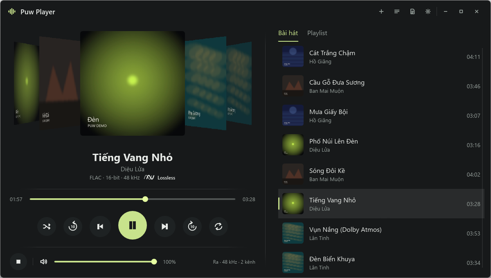
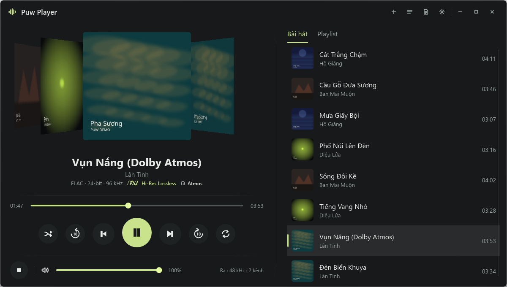
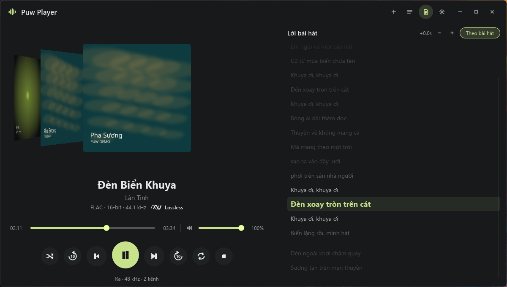
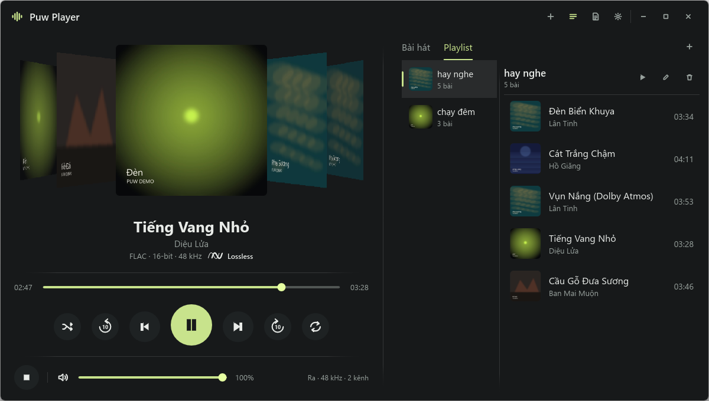
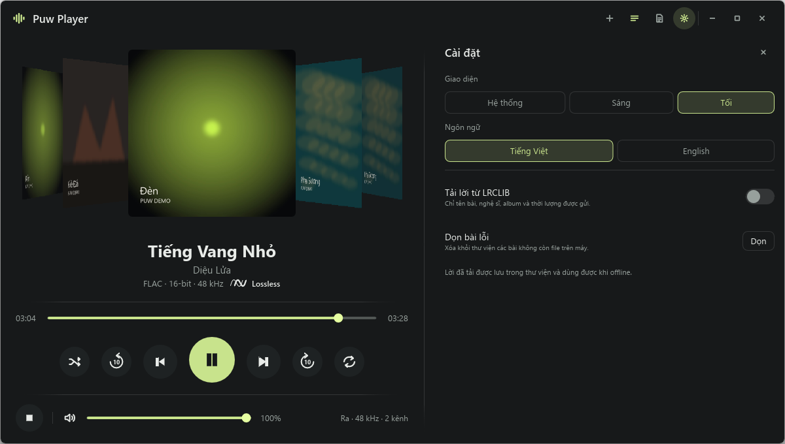
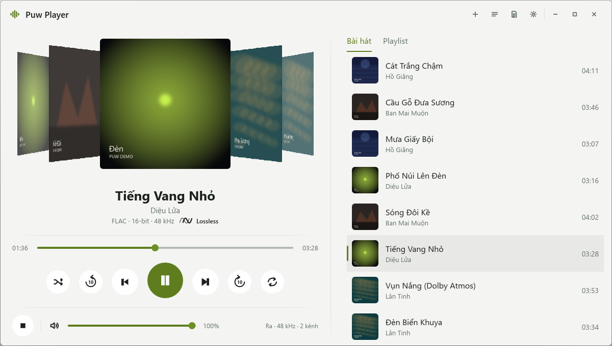

<p align="center"></p>

<h1 align="center">Puw Player</h1>

<p align="center">An offline music player for Windows · <a href="README.md">Tiếng Việt</a></p>

Puw Player plays **music that is already on your computer**. No streaming, no account, no subscription, no ties to Spotify, Apple Music or any other platform. The only network use is looking up **lyrics** for songs you already have (LRCLIB, off by default).

## Features

| Area | What you get |
|---|---|
| Library | Add files or whole folders. Only paths are stored; your files are never copied, moved or deleted. Remove a song from the library (trash button on the row) or clean up every song whose file is gone (Settings → Clean up broken songs); music files stay on disk. |
| Playback | Play/pause, stop, previous/next, ±10 s seek, draggable timeline, volume. |
| Queue | Shuffle without repeats, Previous returns to the song you just heard. Repeat: off / all / one. |
| Search | Box on the Songs tab filters by title or artist as you type. |
| Playlists | Create, rename, delete. Add songs from the Songs tab, remove songs from a playlist. Deleting a playlist never deletes music files. |
| Quality | A badge after the source details: **Hi-Res Lossless** (lossless 24-bit or above 48 kHz), **Lossless** (FLAC, ALAC, WAV…), or the bitrate for compressed files (e.g. 320 kbps). Releases named "Dolby Atmos"/"Binaural" get an extra label with a headphones icon. |
| Cover flow | Current cover in the middle, two covers on each side from the queue, sliding when the track changes. |
| Lyrics | A `.lrc` file next to the song first, then saved lyrics, then LRCLIB if you turn it on. Synced to playback, click a line to seek, per-song ±0.5 s offset. Downloaded lyrics work offline. |
| Windows | Shows up in the Windows media flyout and answers keyboard media keys. "Now playing" readers such as PUW Notch can see it too. |
| Interface | System / light / dark theme, Vietnamese / English, respects Windows reduced-motion setting. |
| Shortcuts | `Space` play/pause · `←` `→` seek 10 s · `↑` `↓` volume · `Esc` close the open panel. |

## Screenshots

| | |
|---|---|
| <br>**Now playing**: cover in the middle, two neighbours on each side taken from the queue, sliding on track change | <br>**Quality**: FLAC 24-bit / 96 kHz earns the **Hi-Res Lossless** label; a release named "Dolby Atmos" gets the headphones label too |
| <br>**Lyrics**: the current line lights up, click a line to seek, ±0.5 s offset per song | <br>**Playlists**: create, rename, add and remove songs; music files are untouched |
| <br>**Settings**: theme, language, LRCLIB lyrics, broken-song cleanup | <br>**Light theme** — follows the system / light / dark |

The screenshots use a self-generated demo library (song names, artists, albums, artwork and lyrics are all synthetic data produced for this project) so that no real recording's copyright is involved.

## Privacy

| Sent over the network | When |
|---|---|
| Title, artist, album, duration | Only with "Fetch lyrics from LRCLIB" on, for songs without lyrics yet. |
| File paths, audio | Never. |

## Formats

| Format | Status |
|---|---|
| FLAC, WAV PCM, M4A (AAC-LC) | Played and checked on real files. |
| MP3 | Tags are read; playback not fully tested yet. |
| WMA, APE, DSD, Opus, HE-AAC | Not supported. |

## Build and run

Needs Windows 10/11 and [Rust](https://rustup.rs) 1.92 or newer (MSVC toolchain).

```bash
cargo build --release
```

The app is `target/release/puw-player.exe`. The library starts empty; add music with the **+** button at the top. Data (library, playlists, settings, saved lyrics) lives in `%APPDATA%\puw-player\library.db`.
The exe carries the icon and version info (Properties → Details) taken from `version` in `Cargo.toml`. It is not code-signed, so SmartScreen or antivirus may still warn after a download; tick Properties → **Unblock** on the zip before extracting.

## Development

```bash
cargo test --no-default-features     # core tests, no audio device needed
cargo clippy --all-targets -- -D warnings
```

Rust + [Slint](https://slint.dev) for the interface, Rodio/Symphonia for audio, SQLite for data. The icon is drawn by `assets/make_icon.py`.

## License

[MIT](LICENSE)

## Limitations

- No drag-and-drop into the window yet; add music with the **+** button.
- Artwork comes only from images embedded in the file; `cover.jpg` in the folder is not read yet.
- Windows Snap Layouts and 125%/150% DPI displays have not been tested thoroughly.
