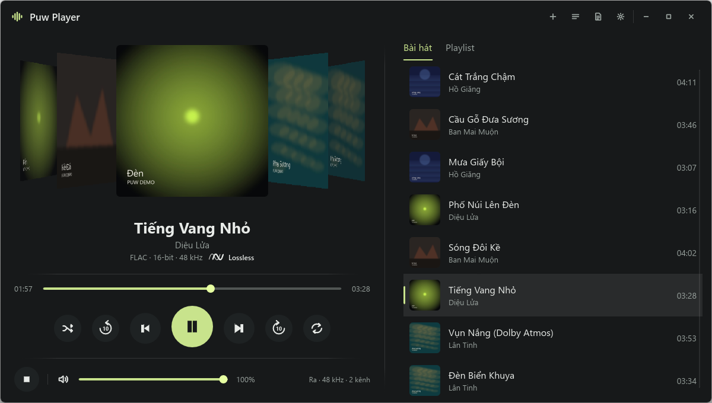
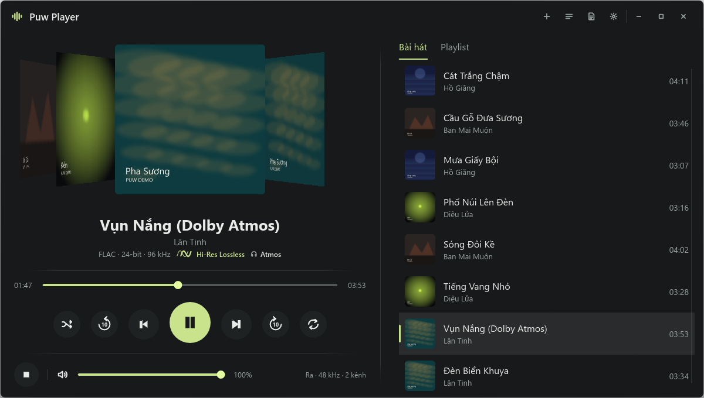
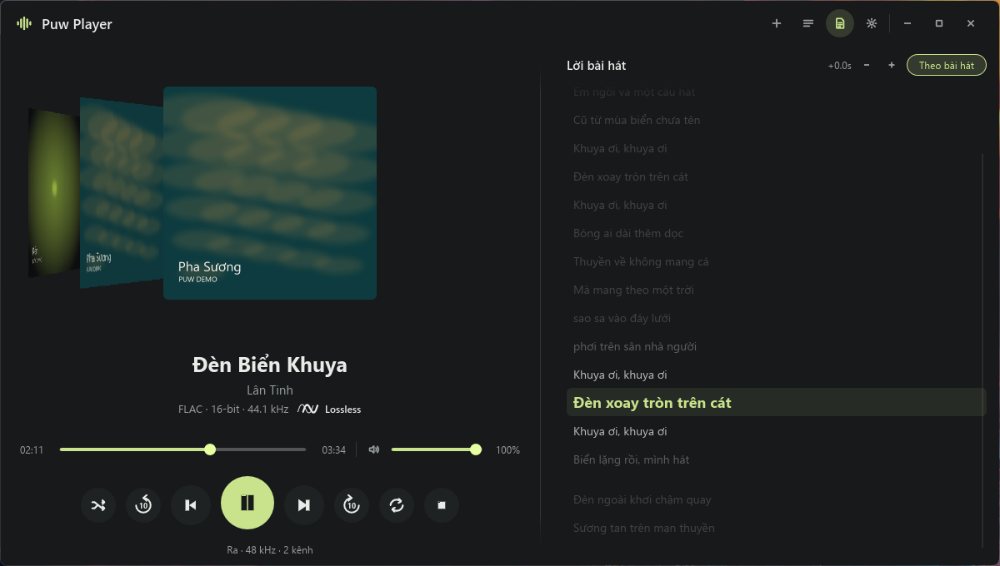
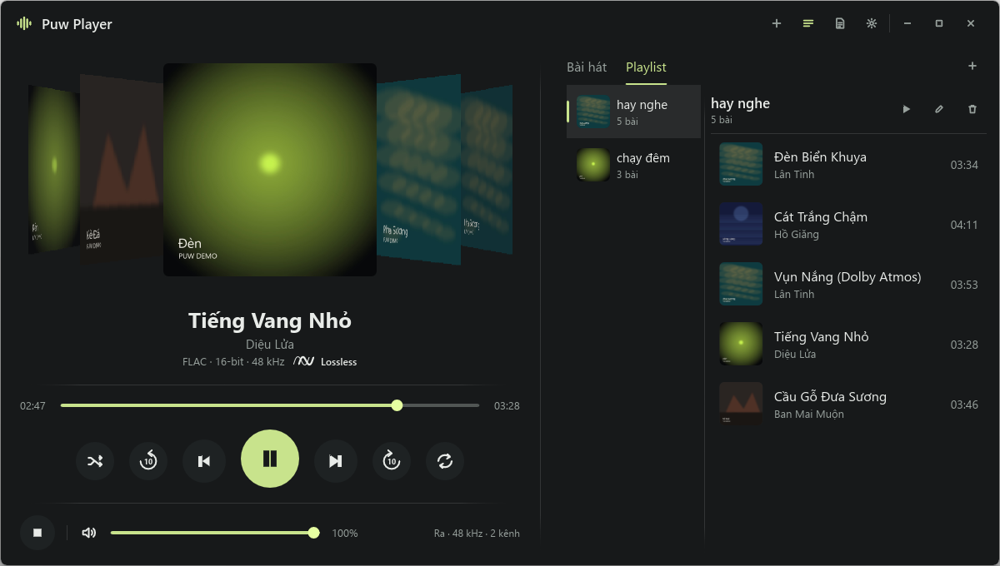
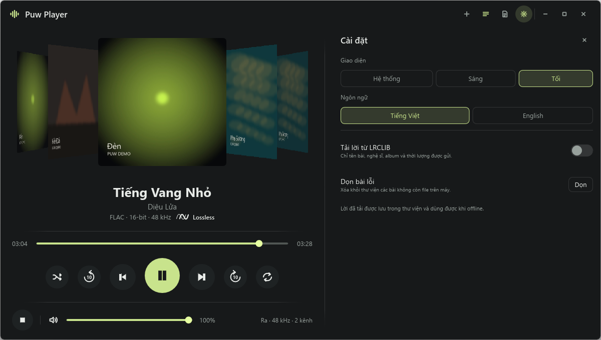
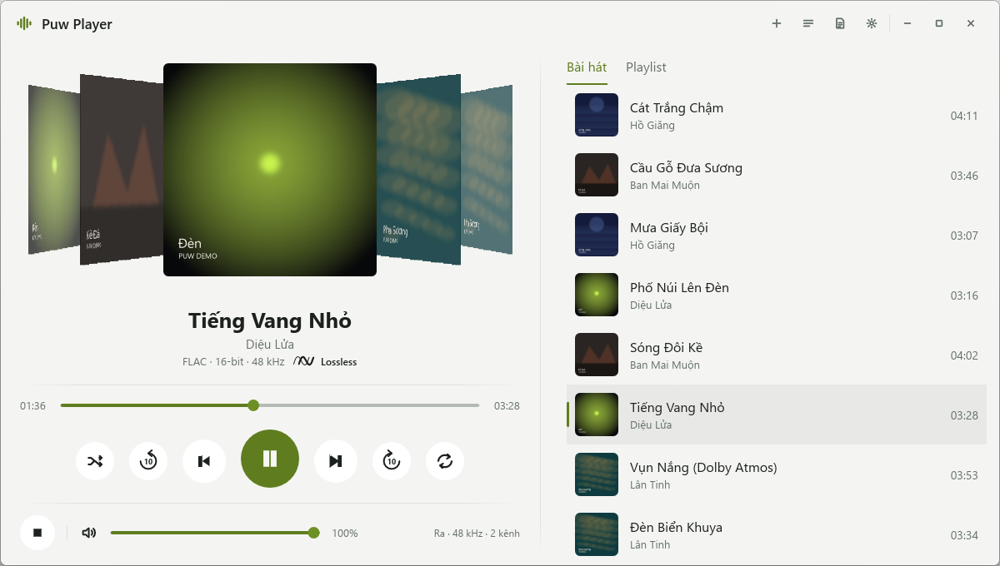

<p align="center"></p>

<h1 align="center">Puw Player</h1>

<p align="center">Trình nghe nhạc offline cho Windows · <a href="README.en.md">English</a></p>

Puw Player phát nhạc có sẵn trên máy bạn. Không stream, không tài khoản, không thuê bao. Kết nối mạng duy nhất là tra lời bài hát (LRCLIB, mặc định tắt).

> **Chỉ tải từ nguồn của tác giả.** Puw Player do tác giả (erikpuw) phát hành duy nhất tại [github.com/erikpuw/puw-player](https://github.com/erikpuw/puw-player). Bản tải từ nơi khác (trang chia sẻ, kho khác, bản đóng gói lại, tệp gửi qua mạng) không do tác giả kiểm soát và không được đảm bảo: có thể đã bị sửa hoặc chèn thêm mã. Hãy chỉ dùng bản ở mục [Releases](https://github.com/erikpuw/puw-player/releases) của kho này.

## Tính năng

- **Thư viện:** thêm tệp hoặc cả thư mục. App chỉ nhớ đường dẫn, không sao chép, di chuyển hay xóa file nhạc của bạn. Có thể xóa bài khỏi thư viện, hoặc dọn các bài không còn file ở mục Cài đặt.
- **Phát nhạc:** phát, tạm dừng, dừng, bài trước và sau, tua 10 giây, kéo thanh thời gian, chỉnh âm lượng.
- **Trộn bài và lặp lại:** trộn bài không lặp, lặp tắt, tất cả hoặc một bài.
- **Tìm bài:** ô tìm ở tab Bài hát và trong từng playlist, lọc theo tên bài hoặc nghệ sĩ.
- **Playlist:** tạo, đổi tên, xóa, thêm và bỏ bài. Xóa playlist không xóa file nhạc.
- **Chất lượng:** huy hiệu Hi-Res Lossless, Lossless hoặc bitrate hiện ngay cạnh thông số bài.
- **Lời bài hát:** lấy từ file `.lrc` cạnh bài, lời đã lưu, hoặc LRCLIB nếu bạn bật. Lời chạy theo nhạc, bấm một dòng để tua, chỉnh lệch ±0,5 giây cho từng bài.
- **Windows:** hiện trong bảng media của Windows, nhận phím media. Các app đọc "đang phát" như PUW Notch thấy được bài hát và trạng thái trộn bài, lặp lại, rồi điều khiển ngược lại được.
- **Giao diện:** theme hệ thống, sáng hoặc tối, tiếng Việt hoặc English.
- **Phím tắt:** `Space` phát hoặc tạm dừng, `←` `→` tua, `↑` `↓` âm lượng, `Esc` đóng lớp đang mở.

## Ảnh chụp

| | |
|---|---|
| <br>Đang phát | <br>Huy hiệu chất lượng |
| <br>Lời bài hát | <br>Playlist |
| <br>Cài đặt | <br>Theme sáng |

Ảnh chụp dùng thư viện mẫu tự dựng (tên bài, nghệ sĩ, ảnh bìa và lời đều là dữ liệu demo) để không dính bản quyền bài hát thật.

## Riêng tư

| Gửi ra ngoài | Khi nào |
|---|---|
| Tên bài, nghệ sĩ, album, thời lượng | Chỉ khi bật "Tải lời từ LRCLIB" và bài chưa có lời. |
| Đường dẫn file, nội dung nhạc | Không bao giờ. |

## Định dạng

| Định dạng | Trạng thái |
|---|---|
| FLAC, WAV, M4A (AAC) | Đã thử phát thật. |
| MP3 | Đọc được thông tin bài, chưa thử kỹ việc phát. |
| WMA, APE, DSD, Opus, HE-AAC | Chưa hỗ trợ. |

## Cài và chạy

Cần Windows 10 hoặc 11 và [Rust](https://rustup.rs) 1.92 trở lên.

```bash
cargo build --release
```

File chạy là `target/release/puw-player.exe`. Lần đầu thư viện trống, thêm nhạc bằng nút **+** ở góc trên. Dữ liệu nằm trong `%APPDATA%\puw-player\library.db`.

File exe chưa có chữ ký số, nên ngoài nguồn chính chủ ở đầu trang không có cách nào khác xác nhận file là của tác giả. Windows SmartScreen hoặc antivirus có thể cảnh báo. Nếu tải file zip, bấm chuột phải, chọn Properties, tick **Unblock** rồi mới giải nén.

## Hạn chế

- Chưa kéo thả file vào cửa sổ, thêm nhạc qua nút **+**.
- Ảnh bìa chỉ lấy từ ảnh nhúng trong file, chưa đọc `cover.jpg` trong thư mục.
- Snap Layouts của Windows và màn hình DPI 125%, 150% chưa được kiểm tra kỹ.

## Giấy phép

[MIT](LICENSE)
